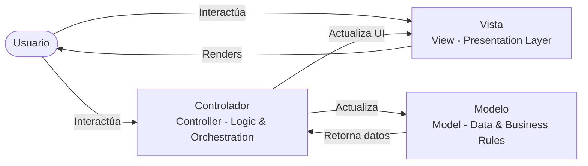
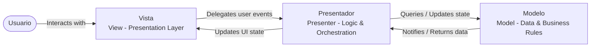
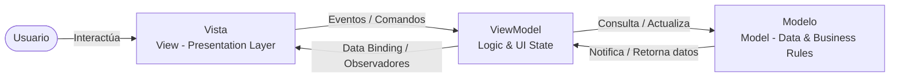
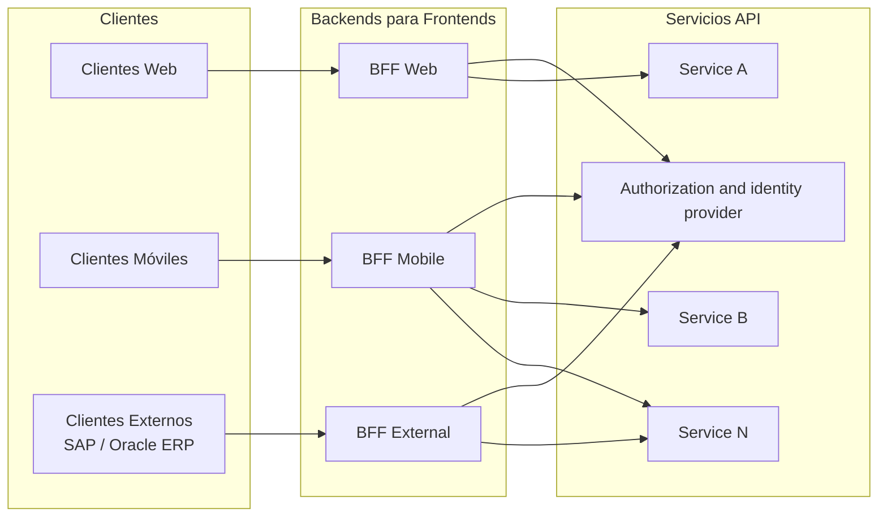

# ARQUITECTURAS PARA APLICACIONES MÓVILES

MSc. Feisar Moreno

---

## MVC (*Model-View-Controller*)

- **Estructura:** El Controlador gestiona la navegación e interacción. La Vista se puede acoplar al Modelo.
- **Limitación:** En aplicaciones móviles complejas genera acoplamiento excesivo en el Controlador, dificultando el mantenimiento.
- **Uso Recomendado:** Prototipos rápidos o aplicaciones cliente con baja complejidad de estado.

---

## MVP (*Model-View-Presenter*)

- **Estructura:** La Vista es pasiva e interactúa a través de una interfaz. El *Presenter* contiene la lógica de presentación.
- **Ventaja Principal:** Permite pruebas unitarias puras del *Presenter* sin dependencias del *framework* UI móvil.
- **Uso Recomendado:** Aplicaciones nativas tradicionales con requisitos estrictos de cobertura de pruebas.

---

## MVVM (*Model-View-ViewModel*)

- **Estructura:** El *ViewModel* expone un estado observable. La Vista se vincula mediante enlace de datos y comandos.
- **Ventaja Principal:** Elimina código repetitivo de interfaz y desacopla por completo la vista del ciclo de vida.
- **Uso Recomendado:** Estándar moderno en desarrollo nativo (Android/iOS) e híbrido.

---

## Arquitectura Reactiva Unidireccional

### Patrón Reactivo: *Model-View-Intent* (MVI)

- **Problemática Bidireccional:** En patrones tradicionales, múltiples eventos de usuario y *callbacks* asíncronos mutan el estado de forma concurrente, produciendo inconsistencias visuales.
- **Principios MVI (*Model-View-Intent*):** El estado del cliente móvil se trata como un objeto inmutable. Las interacciones del usuario emiten intenciones que producen un nuevo estado único.
- **Trazabilidad y Pruebas:** Al restringir el flujo a una sola dirección, cada cambio de interfaz es predecible, reproducible y fácilmente auditable en pruebas automáticas.

### Flujo del patrón

1. ***Intents* / Acciones del Usuario:** Las interacciones en la pantalla (clics, gestos, entradas) se transforman en objetos de intención discreta.
2. ***State Reducer* / *Model*:** Funciones puras procesan la intención junto al estado actual para calcular de forma síncrona el nuevo estado inmutable.
3. ***View Rendering*:** La interfaz móvil recibe el nuevo estado y se renderiza de manera declarativa sin modificar variables globales.

---

## Patrón *Backend for Frontend* (BFF) (I)

### Desafíos en Móviles

- **Ancho de Banda y Batería:** Las redes móviles imponen latencia variable. Requerir múltiples llamadas HTTP para construir una sola pantalla agota la batería del dispositivo.
- ***Backends* Generales Web:** Un API genérico diseñado para clientes de escritorio suele retornar *payloads* masivos no utilizados por la app móvil (*Over-fetching*).
- **Acoplamiento Excesivo:** Obligar al cliente móvil a orquestar microservicios internos expone la topología de la red y dificulta la evolución del *backend*.

---

## Patrón *Backend for Frontend* (BFF) (II)

- **Capa de Agregación Específica:** Un BFF actúa como un *backend* dedicado para la app móvil (ej. iOS BFF / Android BFF). Agrega múltiples llamadas a microservicios en 1 sola respuesta optimizada.
- **Formateo y Filtrado de Datos:** Realiza la transformación de tipos, formateo de imágenes/fechas y eliminación de campos redundantes en el servidor antes de transmitir por red móvil.
- **Autonomía de Equipos:** Permite que el equipo de desarrollo móvil mantenga su propio BFF, alineando los despliegues de la API con los ciclos de la aplicación.

---

## *Gateways* Centralizados

### API *Gateway* Móvil

- **Entrada Centralizada:** Proporciona un punto de acceso unificado para la aplicación cliente móvil.
- **Seguridad y Control:** Gestiona autenticación, uso de TLS (*Transport Layer Security*) y protección contra abusos de red.
- **Enrutamiento Dinámico:** Dirige solicitudes a servicios o BFFs correspondientes en el *backend*.

### *Service Dictionary* y Versionado

- **Catálogo de *Endpoints*:** Por medio de un *endpoint* de configuración (`/config/dictionary`), se entrega un mapa de URLs activas para un servicio.
- **Versionado de APIs:** Es crucial en desarrollo para móviles. Permite dar soporte continuo a versiones antiguas instaladas en dispositivos que los usuarios no actualizan.
- **Contratos Estables:** Evita la rotura de funcionalidad cliente mediante esquemas retrocompatibles.

---

## GraphQL

### *GraphQL* en Clientes Ricos

- **Consultas a Medida:** El cliente móvil especifica de forma exacta la estructura del *payload* que requiere.
- **Ajuste de Datos:** Recupera objetos anidados complejos en una única consulta de red sin sobrecarga.
- **Tipado Fuerte:** Esquemas e introspección que facilitan la generación automática de modelos en el cliente.

**Comparación (diagrama de la diapositiva):**

| REST API | GraphQL API |
|---|---|
| El cliente realiza varias llamadas: `/products`, `/discounts` y `/checkouts`, cada una hacia su propia fuente de datos. | El cliente realiza una única consulta `{ products, discounts, checkouts }` que se resuelve contra las distintas fuentes de datos. |

---

## Arquitectura *Offline-First*

### Estrategias y Almacenamiento *Offline-First*

- **Base de Datos Local como Fuente Primaria:** La interfaz móvil lee prioritariamente del almacenamiento local (ejemplo: *SQLite*) y no de la red directamente.
- **Sincronización Asíncrona y Colas:** Las acciones en modo desconectado se encolan localmente y se reintentan con políticas de reintento progresivo al recuperar señal.
- **Resolución de Conflictos:** Estrategias de consistencia eventual para conciliar modificaciones locales con la base de datos central.
- **Fragmentación de Hardware:** Gestión cuidadosa de cuotas de almacenamiento en disco e impacto en dispositivos de gama baja.

### *Mobile Backend as a Service* (MBaaS / BaaS)

- **Servicios Gestionados en Nube:** Adopción de plataformas de infraestructura gestionada para abstraer autenticación, notificaciones *push* y almacenamiento no estructurado.
- **Aceleración del Desarrollo:** Permite centrar el esfuerzo de ingeniería en la experiencia cliente móvil delegando la infraestructura genérica.
- **Evaluación de Dependencia:** Evaluar el nivel de acoplamiento al proveedor frente al coste de construir y mantener *backend* propio.
- **Telemetría y *Mobile Analytics*:** Captura automática de cierres inesperados y métricas de rendimiento en red desde el cliente.

---

## Configuración Guiada por Servidor

### El Cuello de Botella de las App Stores Públicas

- **Ciclos de Aprobación Lentos:** A diferencia de la web, actualizar una app requiere enviar el binario a tiendas públicas y esperar la revisión.
- **Fragmentación de Versiones Instaladas:** Los usuarios no actualizan la app inmediatamente, obligando a convivir con múltiples versiones del cliente en producción.
- **Riesgo Operativo:** Un error crítico en lógica cliente no puede corregirse al instante si depende de un nuevo despliegue en la tienda.

### Solución: Lógica y UI Guiada por Servidor

- **Configuraciones Dinámicas por *Backend*:** Mover parámetros operativos (intervalos de consulta, *time-outs*, reintentos) a respuestas JSON del servidor.
- ***Server-Driven UI* (SDUI):** El *backend* envía la estructura e instrucciones de *layout*, permitiendo modificar pantallas en tiempo real sin compilar nuevo código cliente.
- **Mitigación de Picos de Tráfico:** Cambiar dinámicamente el comportamiento de la app cliente ante degradaciones de servicio en el servidor sin pasar por las tiendas.

---

## Desarrollo Nativo vs. Multiplataforma

| Criterio de Evaluación | Desarrollo Móvil Nativo (Swift / Kotlin) | Multiplataforma (Flutter / React Native) |
|---|---|---|
| **Rendimiento y HW** | Acceso directo sin capas intermedias. Rendimiento máximo para procesamiento gráfico, AR/VR y procesamiento pesado en dispositivo. | Puentes de comunicación o renderizado propio. Excelente rendimiento para apps de negocio estándar; ligero sobrecoste. |
| **Evolución de Código** | Dos bases de código totalmente independientes (iOS / Android). Duplicación de lógica de negocio y esfuerzo de mantenimiento. | Código único compartido para la lógica y la interfaz. Reducción sustancial de esfuerzo y sincronización de funcionalidades. |
| **Equipos y Carga** | Equipos especializados por plataforma. Alta carga cognitiva y riesgo de inconsistencia de funcionalidades entre plataformas. | Equipos multidisciplinares alineados por producto. Menor barrera de entrada y rápida iteración. |

---

## Elección Según las Restricciones de Negocio

### Análisis de Compromisos (*Trade-Off Analysis*)

- **No existen Soluciones Únicas:** Toda decisión arquitectónica en móvil implica renunciar a algo: rendimiento vs. tiempo de desarrollo, desacoplamiento vs. simplicidad.
- **La Arquitectura "Menos Mala":** Seleccionar el conjunto de compromisos más adecuado balanceando presupuesto, madurez del equipo y perfil del usuario final.
- **Evitar la Sobreingeniería:** No introducir BFF, GraphQL u *Offline-First* si la aplicación es un prototipo simple o tiene baja concurrencia.
